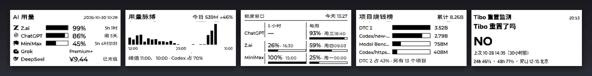
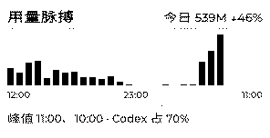
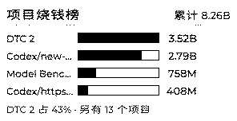
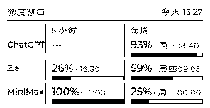
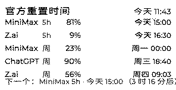
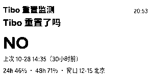
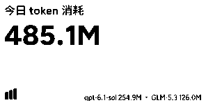
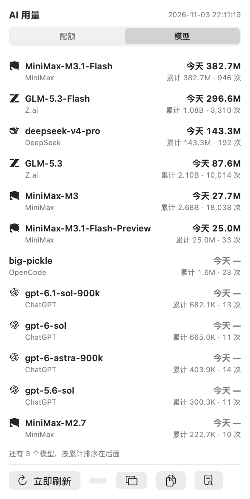

# dot-usage

[](https://github.com/KevPH2026/dot-usage/actions/workflows/ci.yml)
[](LICENSE)

> **Your AI coding quota, burning down in real time — on a 296×152 e-ink screen.**

把 Codex、Claude Code、MiniMax、OpenCode、Hermes、z.ai 的**配额消耗**和 **token 账单**汇成 7 张卡，推到 DOT 电子墨水屏上，再配一个 macOS 菜单栏面板随时点开看。给同时开着好几个 AI 编程工具、月底才发现额度烧穿的人用。



---

## 为什么做这个

- **配额烧完了你才知道。** ChatGPT 的 5 小时窗口在你写代码的时候就没了。等报错再去切窗口，已经来不及了。
- **平台太多，来回切。** ChatGPT、z.ai、MiniMax、Claude Code、OpenCode……每个平台的配额页长得都不一样，进度条藏得都不一样。
- **屏幕太小，只能放最关键的数字。** 296×152，一屏 4 行。所以每张卡只回答一个问题：还剩多少、什么时候烧完、钱花在哪。

---

## 屏幕长什么样

墨水屏上七张卡，每张一屏：

| | |
|---|---|
| <br>**用量脉搏** —— 什么时候在烧 | <br>**项目烧钱榜** —— 钱花在哪 |
| <br>**额度窗口** —— 5 小时 / 周 双栏 | <br>**官方重置时间** —— 什么时候重置 |
| <br>**Tibo 重置监测** —— 广域额度要不要重置 | <br>**今日速览** —— 今天烧了多少 |

菜单栏那一端：抬头是各平台配额，点开是逐平台明细、模型排行和最近 24 小时的曲线。



---

## 特性

- **七张卡，一屏一个问题。** 用量消耗 / 用量脉搏 / 项目烧钱榜 / 官方重置时间 / 额度窗口 / Tibo 重置监测 / 今日速览。
- **「什么时候烧完」比「几天后重置」有用。** 官方给的是「窗口内已用 %」+「窗口还剩多久」，反推日均速率就能算出还够烧几小时。实测：ChatGPT 周窗口已用 90%、5.3 天后重置 → 窗口才过去 1.7 天 → 53%/天 → 剩下那 10% 只够 **4.5 小时**。**重置是官方的，烧完是你自己的。**
- **配额数字全部来自平台官方接口**，不是本地估算：ChatGPT、z.ai、MiniMax、DeepSeek 的已用 % 和重置时刻都直接取官方返回值。
- **数据源是插件。** 每个工具在 `sources.toml` 里声明「去哪儿读、读什么字段、算它属于哪个平台」，内置 `sqlite_usage` 和 `jsonl_usage` 两个通用适配器——**接自己的工具不用改一行 Python**。
- **两个查看入口，互相不知道对方存在。** 墨水屏负责「抬眼就看到」，菜单栏负责「随时点开看细节」；两者读同一个本地状态文件。
- **图片卡全部转 1bit 纯黑白。** 墨水屏只有黑白两色，灰阶抗锯齿图会被设备抖动成噪点，小字直接看不清。
- **零第三方依赖。** 只用 Python 标准库，HTML → PNG 借本机 Chrome headless。
- **数据不出本机。** 不发任何网络请求到外部服务（除了问平台官方接口拿配额），屏幕上的内容只有你自己看得到。

---

## 快速开始

```bash
# 1) 装（Python 3.11+，macOS 14+，零第三方依赖）
git clone https://github.com/<你的账号>/dot-usage.git
cd dot-usage && python3 -m pip install -e .

# 2) 自检：日志读到了没、密钥从哪来、浏览器在不在
dot-usage doctor

# 3) 采一次，先在本地看排版（不用推设备）
dot-usage preview --out ~/dot-usage-preview.html
```

不想装包：`PYTHONPATH=src python3 -m dotusage.cli collect`。

推到设备上还需要两样东西：

```bash
# DOT 的 API Key：放环境变量或 macOS 钥匙串，不进代码、不进日志
security add-generic-password -a "$USER" -s dot-usage -w 'dot_app_你的密钥'

# 设备上要有内容项：画板 API（Tibo 屏）/ 图像 API（五张图卡）/ 文本 API（今日速览）
# 在 Dot. App → Content Studio 里建好，然后：
dot-usage run
```

常用命令：

| 命令 | 作用 |
|---|---|
| `dot-usage run` | 采集 → 推墨水屏 |
| `dot-usage collect` | 只采集，写状态文件，并打印每个源读到几行 |
| `dot-usage preview` | 生成 HTML 预览（按 296×152 真实几何） |
| `dot-usage pages` | 打印会切成哪几屏、每屏放什么 |
| `dot-usage switch` | 让墨水屏立刻切到下一屏 |
| `dot-usage doctor` | 自检：配置 / 密钥 / 设备 / 浏览器 |
| `dot-usage show` | 打印当前状态摘要 |
| `dot-usage sources` | 列出生效的数据源（`--init` 生成默认配置） |
| `dot-usage sinks` | 打印各输出目标的开关状态 |

采集周期默认 15 分钟（`config.json` 里的 `interval_minutes`）。

---

## 支持的数据源

| 工具 | 用量数据从哪读 | 官方配额从哪来 |
|---|---|---|
| Codex (OpenAI) | `~/.codex/sessions/**/*.jsonl` | `chatgpt.com/backend-api/wham/usage`（7 天 / 5 小时窗口） |
| ZCode / z.ai (GLM) | `~/.zcode/cli/db/db.sqlite` | `api.z.ai/api/monitor/usage/quota/limit`（5 小时 / 周窗口） |
| MiniMax Code | `~/.minimax/sqlite.db` | `www.minimaxi.com/v1/api/openplatform/coding_plan/remains` |
| Claude Code | `~/.claude/projects/**/*.jsonl` | 官方没给配额接口，只有本地消耗 |
| OpenCode | `~/.local/share/opencode/opencode.db` | — |
| Hermes | `~/.hermes/state.db` | — |
| Grok / xAI | 本地花费 | `grok.com/rest/subscriptions`（只有订阅档位，没有配额 %） |
| DeepSeek | — | `api.deepseek.com/user/balance`（只有余额） |

**只读 token 计数，不读对话内容。** 所有本地源都只取用量数字和时间戳，不取你的 prompt 和回复。

---

## 配自己的数据源

每个工具一段 TOML，写在 `~/.config/dot-usage/sources.toml`：

```toml
[[source]]
id = "mytool"
name = "MyTool"
platform = "自家"
adapter = "sqlite_usage"

[source.options]
db = "~/.mytool/data.db"
sql = "SELECT model AS model, ts AS ts, total_tokens AS total FROM usage WHERE ts > :since"
time_scale = 0.001
window_hours = 24
```

上面这五行就能接一个新工具 —— **不用改 Python**。内置两个通用适配器：

- `sqlite_usage`：一条 SQL + 一份列名别名（`model` / `input` / `output` / `total` / `ts` / `cost` …）
- `jsonl_usage`：一份字段路径（`message.usage.input_tokens` 这种点号路径）

字段表、两个适配器的完整例子、怎么加自己的官方配额 provider、怎么本地调试：[docs/SOURCES.md](docs/SOURCES.md)。

现成的例子文件：[examples/sources.example.toml](examples/sources.example.toml)（最小可用）、[examples/sources.generic.example.toml](examples/sources.generic.example.toml)（上面 8 个工具全用通用适配器重写了一遍）。

---

## 七张卡

每张卡的显示内容、数据来源、对应代码位置：[docs/CARDS.md](docs/CARDS.md)。

| # | 卡片 | 回答什么问题 |
|---|---|---|
| 1 | Tibo 重置监测 | OpenAI 的广域额度要不要重置？ |
| 2 | 用量消耗 | 所有平台还剩多少配额、什么时候重置？ |
| 3 | 用量脉搏 | 过去 24 小时什么时候在烧？ |
| 4 | 项目烧钱榜 | 钱烧在哪个项目上？ |
| 5 | 官方重置时间 | 每个配额窗口官方说几点重置？ |
| 6 | 额度窗口 | 5 小时窗口和周窗口各用了多少？ |
| 7 | 今日速览 | 今天烧了多少、最费的是哪两个模型？ |

第 4 张卡最直观的一次实测：Codex 累计 8.25B token 里，`DTC 2` 占 **42.6%**，一次性临时聊天占 **33.7%** —— 三分之一的钱烧在不值得复盘的一次性会话上。

---

## 隐私与安全

- **数据只留在本机。** 采集到的用量写进 `~/.local/state/dot-usage/state.json`，不外发。
- **不往外发任何东西。** 除了问平台官方接口取配额百分比，dot-usage 不向任何外部服务发送数据；屏幕上的内容只有你自己看得到。
- **密钥只从环境变量或 macOS 钥匙串读。** 不写进代码、不写进配置文件、不进日志、不进卡片。钥匙串那一条是为了让定时任务在没有登录 shell 的情况下也能工作。
- **不读对话内容。** 本地源只取 token 计数和时间戳。
- **零第三方依赖。** 只用 Python 标准库，没有第三方包在你机器上执行任何东西。
- **日志会自截断。** 日志文件超过 512 KB 自动只留最后 2000 行。

---

## 架构

五层，上层能往下调，反过来不行：

| 层 | 位置 | 职责 |
|---|---|---|
| `core` | `src/dotusage/core/` | 统一行模型 `UsageRow`、合并平台、算「什么时候烧完」 |
| `sources` | `src/dotusage/sources/` | 读本机日志和数据库、问官方接口 |
| `cards` | `src/dotusage/cards/` | 把数据变成一张能看的屏（HTML / PNG / 画板 JSON） |
| `sinks` | `src/dotusage/sinks/` | 输出目标，可插拔：现在只有墨水屏一种，加新的不用改 core |
| `macos` | `menubar/DotUsageBar.swift` | 菜单栏面板，只读状态文件，完全不知道墨水屏存在 |

数据流：

```
本机日志/数据库 ─┐
官方配额接口  ──┴─→ sources ─→ UsageRow ─→ core（合并/聚合）
                                              │
                            ┌─────────────────┼─────────────────┐
                            ↓                 ↓                 ↓
                          cards            cards             cards
                            │                 │                 │
                            └─────────────────┴─────────────────┘
                                              ↓
                                     sinks（可插拔）
                                              ↓
                                    DOT 墨水屏 / 本地状态文件
                                              ↓
                                     macOS 菜单栏面板
```

为什么这么分、墨水屏图为什么必须转 1bit、为什么只有第一个内容项 `refreshNow`、状态文件契约、三个扩展点怎么写：[docs/DESIGN.md](docs/DESIGN.md)。

---

## 贡献

- 想加一个工具 → 写一段 TOML，不用改代码，最有价值的 PR 就是这个。
- 想加一张卡 → 在 `src/dotusage/cards/` 加模块，注意 296×152 一屏最多 4 行。
- 想加一个输出目标 → 继承 `sinks/base.py` 的 `Sink`。
- 提交前跑一遍 `dot-usage doctor` 和 `dot-usage preview`。

## License

[MIT](LICENSE)

---

**English** — dot-usage turns the quota of your AI coding tools (ChatGPT/Codex, z.ai, MiniMax, Claude Code, OpenCode, Hermes, Grok, DeepSeek) into seven cards for a 296×152 e-ink screen, plus a macOS menu bar panel for the details. Quota percentages and reset times come from each vendor's official API; token burn comes from logs that are already on your machine. Adding a tool is a TOML file, not a patch. Python 3.11+, zero third-party dependencies, and nothing leaves your machine.
