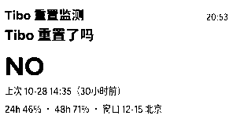
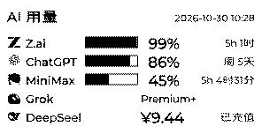
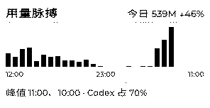
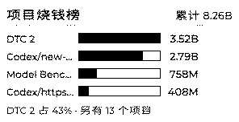
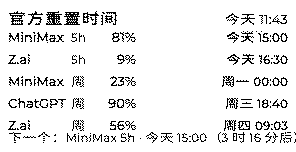
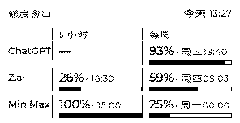
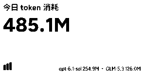

# 七张卡

设备屏是 **DOT Quote/0，296×152，1bit 黑白**。每张卡占一屏，设备按内容项轮播。
七张卡对应 DOT 的三种内容项：**画板 API**（Tibo 那一屏）、**图像 API**（五张图卡）、**文本 API**（今日速览）。

| # | 卡片 | 类型 | 代码 |
|---|---|---|---|
| 1 | Tibo 重置监测 | 画板 API | `src/dotusage/core/tibo.py` + `src/dotusage/cards/canvas.py` |
| 2 | 用量消耗 | 图像 API | `src/dotusage/cards/usage.py` |
| 3 | 用量脉搏 | 图像 API | `src/dotusage/core/pulse.py` |
| 4 | 项目烧钱榜 | 图像 API | `src/dotusage/core/projects.py` |
| 5 | 官方重置时间 | 图像 API | `src/dotusage/cards/reset_list.py` |
| 6 | 额度窗口 | 图像 API | `src/dotusage/cards/window.py` |
| 7 | 今日速览 | 文本 API | `src/dotusage/sinks/dot.py` |

---

## 1. Tibo 重置监测

**显示什么**

- **YES / NO**：OpenAI 的 Thibault Sottiaux 宣布广域额度重置，到底发没发
- 上次重置时间
- 24h / 48h 概率
- 时间窗口

**数据怎么来的**

社区追踪站 codex-reset.com 的公开 feed。判定规则在
`src/dotusage/core/tibo.py:collect_tibo()`，拿到的结果是一条 `kind = "tibo"` 的 `UsageRow`。

**代码在哪**

- 采集：`src/dotusage/core/tibo.py`
- 排版：`src/dotusage/cards/canvas.py:400`（`_tibo_row()`）、`src/dotusage/cards/canvas.py:438`（`build_canvas()`）
- 推送：`src/dotusage/sinks/dot.py:428`（`push_dot_smart()`，走画板 API）

**为什么它单独占一屏**：这是二元事件，必须稳定可见。轮播模式下它可能几十分钟都轮不到，
所以画板只放这一屏（`build_pages(..., only_tibo=True)`）。

---

## 2. 用量消耗

**显示什么**

一屏放下所有平台：配额 %、进度条、重置倒计时、余额、工具额度。

**数据怎么来的**

- 配额 % 和重置时刻：全部来自**平台官方接口**（`src/dotusage/official/providers.py`）
- token 消耗：本机日志和数据库（`src/dotusage/sources/`）
- 合并成一平台一行：`src/dotusage/core/aggregate.py:91`（`aggregate()`）
- 「什么时候烧完」：`src/dotusage/core/aggregate.py:54`（`predict_exhaust()`）

**代码在哪**

- 图像版排版与出图：`src/dotusage/cards/usage.py`
  - `build_html()` / `render_png()` / `to_1bit()` / `to_gray_png()`（灰阶版只用于对照）
- 画板版行元素：`src/dotusage/cards/canvas.py`
  - `_consumption_row()`（消耗）、`_platform_row()`（平台）、`_balance_row()`（余额）、`_bar()`（进度条）

**「烧完」怎么算的**：官方给的是「窗口内已用 %」+「窗口还剩多久」，
反推窗口已经过了多久 → 日均烧多少 → 剩下那点够烧几小时。

> ChatGPT 周窗口已用 90%，5.3 天后重置 → 窗口才过去 1.7 天 → 53%/天 → 剩下 10% 只够 4.5 小时。

**重置是官方的，烧完是你自己的。**

---

## 3. 用量脉搏

**显示什么**

近 24 小时消耗柱状图（什么时候在烧）、峰值时刻、跟昨天同期比。

**数据怎么来的**

按小时聚合所有源的时间戳：`src/dotusage/core/pulse.py:60`（`collect_hourly()`）。
峰值和同比由 `insight()` 算（`src/dotusage/core/pulse.py:213`）。

**代码在哪**

`src/dotusage/core/pulse.py` —— `collect_hourly()` / `insight()` / `build_html()` / `render_png()`。

出图走本机 Chrome headless（`render_png()` 里找 Chrome / Chromium / Edge）。

---

## 4. 项目烧钱榜

**显示什么**

按 Codex 会话的**工作目录**拆账，谁在烧钱排前四。

**数据怎么来的**

Codex rollout 里每行都带 `cwd`，按目录聚合 token：
`src/dotusage/core/projects.py:111`（`collect_projects()`）。
一次性聊天目录（`/tmp`、随机目录名）会单独归一类。

**代码在哪**

`src/dotusage/core/projects.py` —— `collect_projects()` / `build_html()` / `render_png()`。

**实测**：Codex 累计 8.25B token 里，`DTC 2` 占 **42.6%**，一次性临时聊天占 **33.7%**。
三分之一的钱烧在不值得复盘的一次性会话上 —— 这就是这张卡存在的理由。

---

## 5. 官方重置时间

**显示什么**

每个配额窗口的官方重置时刻，列成表，带倒计时。

**数据怎么来的**

`resets_at` 直接来自官方接口的返回值，不做推算：
- ChatGPT `chatgpt.com/backend-api/wham/usage`
- z.ai `api.z.ai/api/monitor/usage/quota/limit`
- MiniMax `www.minimaxi.com/v1/api/openplatform/coding_plan/remains`

**代码在哪**

`src/dotusage/cards/reset_list.py` —— `reset_rows()` / `build_html()` / `render_png()`。

---

## 6. 额度窗口

**显示什么**

每家平台一行，左边 **5 小时窗口**、右边 **周窗口**，两栏并排，
每栏是百分比 + 重置时刻 + 进度条。

**数据怎么来的**

从所有 `UsageRow` 里挑出每个平台的两个窗口：
`src/dotusage/cards/window.py:86`（`pick_windows()`）。

**代码在哪**

`src/dotusage/cards/window.py` —— `pick_windows()` / `build_html()` / `render_png()`。

这张卡的版式是照用户给的参考样式做的双栏：两栏一屏放完，
不用在「5 小时」和「一周」之间来回翻页。

---

## 7. 今日速览

**显示什么**

一行大字（今日 token 总量）+ 一行签名（最费的两个模型）。

**数据怎么来的**

- 今日总量：`src/dotusage/core/pulse.py:213`（`insight()`）
- 最费的模型：`src/dotusage/core/models.py`（`collect_model_usage()`，今日 + 历史累计）

**代码在哪**

`src/dotusage/sinks/dot.py:411`（`_today_digest()`）→ `src/dotusage/sinks/dot.py:428`（`push_dot_smart()`，走文本 API）。

这是唯一一张**文本卡**：不渲染图片，直接推文本内容项。

---

## 排版为什么这么抠

296×152 实测最多放 **4 行**：标题区 ~24px + 页脚 ~16px + 4 行 × ~26px ≈ 144px。
放 5 行最后一行会压到页脚上（预览里能看到重叠）。
约束写在 `src/dotusage/cards/canvas.py:66`（`build_pages()`）。

所有图片卡出图前都转 **1bit 纯黑白**：墨水屏只有黑白两色，
灰阶抗锯齿图会被设备抖动成噪点，小字直接看不清。
转换函数：`src/dotusage/cards/usage.py:125`（`to_1bit()`）。
